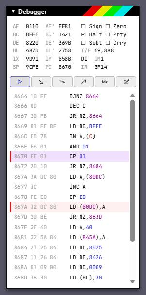
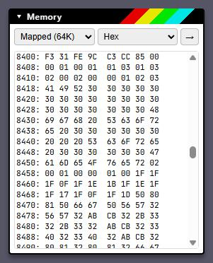
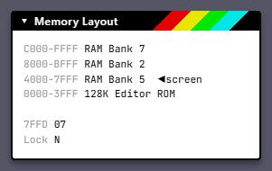
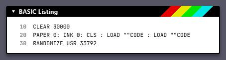
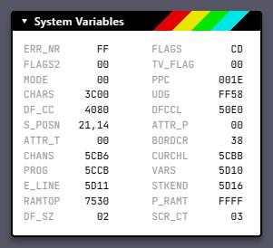
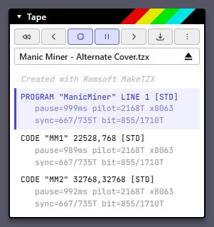

# Developer Tools

ZX84 has a set of in-browser tools for looking inside a running machine: a
debugger with breakpoints and stepping, memory and paging views, a BASIC
lister, system variables, instruction tracing, and screen-text extraction. This
page covers each one, then how to build and work on ZX84 itself.

For scripted or automated work — watchpoints, writing memory, symbol files,
traps, disk forensics — use the [MCP server](../mcp/README.md), which drives a
headless machine through the same machine code the browser uses.

- [Turning the tools on](#turning-the-tools-on)
- [Debugger](#debugger)
- [Tracing](#tracing)
- [Memory](#memory)
- [Memory Layout](#memory-layout)
- [BASIC Listing and Variables](#basic-listing-and-variables)
- [System Variables](#system-variables)
- [Fonts and the TEXT overlay](#fonts-and-the-text-overlay)
- [Inspecting media](#inspecting-media)
- [Saving state](#saving-state)
- [Machine availability](#machine-availability)
- [Working on ZX84](#working-on-zx84)

## Turning the tools on

The developer panes are hidden by default. Open the **⋮** menu beside the ZX84
logo, choose **Developer**, and tick the panes you want:

| Pane | Shows |
| --- | --- |
| Debugger | Registers, flags, step controls, disassembly and breakpoints |
| Memory | Hex/ASCII view of the address space, ROMs and RAM banks |
| Memory Layout | Live paging map: which ROM or RAM bank backs each address range |
| BASIC Listing | The BASIC program in memory, detokenised |
| BASIC Variables | The BASIC variables area, decoded |
| System Variables | Spectrum system variables |
| Fonts | Character sets for the screen-text engine, including a RAM font hunter |
| Text | Layout controls for the TEXT overlay (appears while it is on) |

Panes open in the right-hand sidebar. Drag a pane's title bar to reorder it or
move it to the other sidebar, and click the title to collapse it. Layout,
visibility and collapse state are remembered between sessions. **Developer →
Reset settings** puts the developer group back to its defaults.

**Pause when focus lost**, at the top of the same menu, stops emulation whenever
the tab loses focus.

## Debugger



The Debugger pane works on every machine, Z80 and 6502 alike.

**Registers** sit at the top and update every frame while the pane is open.

- **Z80:** AF, BC, DE, HL and their shadow pairs, IX, IY, SP, PC and IR, plus
  T-states per frame, interrupt state (EI/DI), interrupt mode and HALT. The six
  flags (Sign, Zero, Half-carry, Parity/overflow, Subtract, Carry) are shown as
  ticks; hover one for its meaning.
- **6502:** A, X, Y, P, PC and SP, cycles per frame, and the Sign, Overflow,
  Decimal, IRQ-disable, Zero and Carry flags.

**Editing registers.** While paused, click a register value to edit it in place
as hex: Enter commits, Esc (or clicking away) cancels. Click a flag to toggle
it. On the Z80 this covers every pair including the shadow set, IX, IY, SP, PC,
IR (I and R together) and the interrupt mode, and clicking **EI**/**DI** flips
the interrupt enable. On the 6502 it covers A, X, Y, P, SP and PC. The
disassembly, sysvars and BASIC panes redraw straight away, so changing PC moves
the disassembly with it. Registers are read-only while the machine is running,
since a write would race the frame loop.

**Toolbar**, left to right:

| Button | Action |
| --- | --- |
| Pause / Resume | Stop or continue emulation |
| Step Into | Execute one instruction. A halted Z80 with interrupts enabled steps into its interrupt handler. |
| Step Over | Execute one instruction, running subroutines to completion. On the Z80 this covers CALL and RST, DJNZ, conditional jumps and the repeating block instructions (LDIR and friends); on the 6502, JSR. |
| Step Out | Run until the current routine returns |
| Step Frame | Run to the end of the current video frame and redraw |
| Copy (clipboard) | Copy the CPU state to the clipboard — see below |
| Trace (pencil) | Start a trace — see [Tracing](#tracing) |

The step buttons are available while paused.

**Disassembly** appears while paused, centred on PC. Each line shows the
address, the raw bytes and the instruction; operands are coloured by kind —
immediate values blue, addresses purple, ports red. The Z80 disassembler
includes the undocumented instructions (IXH/IXL, SLL and friends); the 6502
disassembler includes the stable illegal opcodes, and switches to the 65C02
table on the Enhanced //e and //c.

**Breakpoints**

- Double-click a line to toggle a breakpoint on it. Breakpoint lines are marked
  in red; the current instruction is highlighted.
- Right-click a line for **Run to here** (a one-shot breakpoint) and **Toggle
  breakpoint**.
- When a breakpoint is reached the machine pauses and a message shows the
  address.

Breakpoints trigger on execution only. The browser debugger is deliberately
lightweight: it always follows PC. For memory and port watchpoints, symbol files
or breakpoints at arbitrary addresses, use the [MCP server](../mcp/README.md).

**Copying CPU state.** The clipboard button copies a snapshot of the CPU as
text: registers, flags and the next 16 disassembled instructions. It works while
running or paused, and it's a quick way to paste the state of a tight loop
into a bug report or a chat.

<br clear="right">

## Tracing

The Spectrum can record what the CPU does and copy it to the clipboard. Pick a
mode from the pencil menu on the Debugger toolbar; the button turns into
**Stop**, and stopping copies the trace. Traces stop and copy themselves
automatically at 500,000 lines.

| Mode | Output |
| --- | --- |
| **Full** | One line per instruction: address, disassembly and context — memory operand values, whether conditional branches were taken, ports and block-instruction registers. Repeats of the same instruction with identical registers collapse into a single `... loops back to XXXX xN` line, so waiting loops don't drown the trace. |
| **Port IO** | No per-instruction log. Instead, a summary of every port read and written: count, a label for known devices (ULA, Kempston, AY, 7FFD, 1FFD, FDC), the instructions that accessed it, and the values seen. |
| **ZXTrace** | The ZXTL text format: cycle count, address, the four bytes at PC, disassembly and the full register set including MEMPTR, with jumps marked. Useful for diffing against other emulators that write the same format. |

Tracing is currently implemented for the Spectrum. The button also appears on
some other Z80 machines but records nothing yet.

## Memory



The Memory pane shows any part of the machine's memory:

- **Region:** the CPU's current 64K view (**Mapped**), any of the machine's
  ROMs, or a RAM bank. The Jupiter Ace adds its video, character and main RAM;
  the CPC Plus its cartridge pages.
- **Mode:** **Hex** (8 bytes a row), **Hex+ASCII**, or **ASCII** (32 characters
  a row). Characters are drawn in the machine's own character set, so
  Spectrum block graphics and £ signs come out right.
- **→** opens a go-to box: type a four-digit hex address and press Enter.

The view refreshes twice a second while running and holds still while paused
or while you have text selected, so you can copy from it. The region and mode
are remembered.

**Editing memory.** While paused, in Hex or Hex+ASCII mode, click a byte to
overtype it. Type hex digits (the first replaces the high digit, the second the
low one, then the cursor moves to the next byte); the arrow keys move around and
Esc stops editing. In Hex+ASCII mode Tab swaps between the hex and ASCII
columns, and typing a character in the ASCII column writes its code. Writes go
through the selected region:

- **Mapped:** the same write the CPU would make, so a write to ROM is ignored
  and paged memory lands in whichever bank is currently mapped. On the BBC
  Micro, Electron, Apple I and Apple II a mapped write can reach a hardware register and
  trigger its side effects; the pane warns you.
- **RAM bank:** written directly into that bank, wherever it is paged.
- **ROM regions:** read-only until you tick the **ROM** box beside the picker.

The disassembly, sysvars and BASIC panes refresh after each write. Editing is
unavailable while the machine is running.

<br clear="right">

## Memory Layout



Machines that page memory get a live map of what the CPU sees in each address
range, refreshed every frame so you can watch a game switch banks. The screen
and ROM ranges are marked, and the paging registers (for example `7FFD` and the
lock bit on a 128K Spectrum) are listed underneath.

It is available on the 128K-class Spectrums, CPC, Einstein, MSX, MTX, Lynx,
PCW and Enterprise.

<br clear="right">

## BASIC Listing and Variables



**BASIC Listing** shows the program in memory, detokenised, and refreshes about
once a second. **BASIC Variables** decodes the variables area: numbers,
strings, arrays and FOR–NEXT loop variables with their limit and step.

| Machine | Dialect | Listing | Variables |
| --- | --- | --- | --- |
| Spectrum | Sinclair BASIC | ✓ | ✓ |
| ZX80 / ZX81 | Sinclair BASIC | ✓ | ✓ |
| CPC | Locomotive BASIC | ✓ | ✓ |
| MSX | MSX BASIC | ✓ | ✓ |
| BBC Micro, Electron | BBC BASIC II | ✓ | ✓ |
| Einstein | Xtal BASIC | ✓ | |
| MTX | MTX BASIC | ✓ | |

## System Variables



On the Spectrum this pane shows the system variables as a two-column table —
error number, flags, the program, variables and edit-line pointers, RAMTOP,
print position, attributes and so on. Hover a name for a description. The 128K
models add their paging and serial variables, and the +2A/+3 its disk and
paging extras.

<br clear="right">

## Fonts and the TEXT overlay

Click **TEXT** in the status bar under the screen to lay a selectable text copy
of the screen over the picture, so you can copy text straight off it. The
**Text** pane appears while it is on, with font, line height, tracking, offset
and scale controls to line the overlay up with the display.

Character-mapped displays — the Jupiter Ace, the ZX80/ZX81 and BBC Mode 7 — are
read straight out of screen memory. Bitmap displays are recognised by matching
the picture against the machine's character set; on the Spectrum the engine also
detects 51-column (CP/M Plus) and 64-column (Tasword) layouts. The Enterprise
has no text engine yet.

The **Fonts** pane feeds extra character sets to the Spectrum's text engine, for
games that draw text in their own font:

- **Load** a 768-byte `.ch8` or `.bin` font file.
- **Hunt** scans RAM for character sets — via the CHARS system variable, glyph
  signatures, and by matching the screen against candidate fonts.
- Each font found can be saved back out as `.ch8`.

The same text extraction is available to scripts as the MCP `ocr` tool.

## Inspecting media



The media panes double as inspection tools.

**Tape** lists every block on the tape. Spectrum headers are decoded (`PROGRAM
"name" LINE n`, `CODE "name" start,length`, arrays) and tagged as standard,
turbo or pure data. Every block shows its timings: pause, pilot pulse length and
count, sync pulses, bit lengths and used bits. TZX control blocks (pure tones,
pulse sequences, direct recordings, groups, text and archive info) are listed
too. Click a block to move the tape there. The **⋮** menu turns fast ROM
loading, turbo loading, loading sounds, auto-rewind and paired-block combining
on and off.

**Drives** shows a per-drive activity light (motor, seek, read, write) with
live track and sector numbers. Each disk's format is shown, and on the +3 the
copy protection scheme is identified when it recognises one.

**Status lights** under the screen show activity as it happens: keyboard,
Kempston and mouse port reads, tape playback and the tape-loading routine, floppy
controller access, beeper and sound-chip writes, and **RAINBOW** when a Spectrum
program rewrites the attributes mid-frame. Hover a light for its meaning.

<br clear="right">

## Saving state

The **Save** button in the Load / Save pane offers what the current machine
supports:

| Save | Machines |
| --- | --- |
| Snapshot (`.szx`, `.z80`) | Spectrum |
| Snapshot (`.sna` v2/v3) | CPC |
| Screenshot (`.png`) | All |
| Screen (`.scr`) | Spectrum, ZX80/ZX81, CPC, Einstein, MSX, MTX, PCW |
| RAM (`.bin`) | All |
| Saved tape | BBC Micro, Electron, Jupiter Ace, MSX |

Media can also be mounted from URLs at startup — see the
[README](../README.md#media).

## Machine availability

The Debugger, Memory pane, breakpoints and stepping work on every machine. The
rest depend on the hardware:

| Machine | CPU | Tracing | Memory Layout | BASIC | System Variables | Fonts | TEXT |
| --- | --- | --- | --- | --- | --- | --- | --- |
| Spectrum | Z80 | ✓ | 128K models | ✓ | ✓ | ✓ (with Hunt) | ✓ |
| ZX80 / ZX81 | Z80 | | | ✓ | | | ✓ |
| CPC | Z80 | | ✓ | ✓ | | | ✓ |
| Einstein | Z80 | | ✓ | listing | | ✓ | ✓ |
| MSX | Z80 | | ✓ | ✓ | | ✓ | ✓ |
| MTX | Z80 | | ✓ | listing | | ✓ | ✓ |
| Camputers Lynx | Z80 | | ✓ | | | ✓ | ✓ |
| Jupiter Ace | Z80 | | | | | | ✓ |
| Amstrad PCW | Z80 | | ✓ | | | | ✓ |
| Enterprise | Z80 | | ✓ | | | ✓ | |
| BBC Micro, Electron | 6502 | | | ✓ | | | ✓ |
| Apple I | 6502 | | | | | | ✓ |
| Apple II | 6502 / 65C02 | | | | | | ✓ |

## Working on ZX84

### Running locally

```bash
npm install
npm run dev
```

Open the address Vite prints (`http://localhost:5173` by default), choose a
machine in the Hardware pane, then load ROMs and media. The hosted version
supplies the standard ROM sets; local builds can load replacement ROM images
from the ROM pane.

Hot module reloading is off. Save, then refresh the page: on the Spectrum, the
machine's state is snapshotted when the page unloads and restored on reload (if
it is less than a minute old and the model hasn't changed), so a refresh picks
up where you left off.

### Commands

| Command | Does |
| --- | --- |
| `npm run dev` | Start the Vite dev server |
| `npm test` | Run the Vitest suite (`npm run test:watch` to keep it running) |
| `npx tsc --noEmit` | Type-check |
| `npm run depcheck` | Enforce the architecture boundaries in `.dependency-cruiser.cjs` |
| `npm run build` | Type-check and build for production |
| `npm run mcp` | Start the MCP server (`npm run mcp -- --model zx128k` to pick a machine) |
| `npm run mascot` | Regenerate the favicon and mascot images from `tools/build-mascot.ts` |
| `npm run catalog:db`, `catalog:json`, `catalog:zx8x` | Rebuild the software-library catalogs from ZXDB |

Run `npx tsc --noEmit`, `npm test` and `npm run depcheck` before sending a
change; all three must pass.

### Keyboard Lab

The dev server serves a layout editor for the on-screen keyboards at
`/keyboard-lab`: add, align and distribute keys over a reference photo, with
undo, JSON import and TypeScript export. It is not part of production builds.

### Further reading

- [`AGENTS.md`](../AGENTS.md) — architecture, layer rules, performance rules
  and branching conventions. Read this first.
- [`docs/adding-a-machine.md`](adding-a-machine.md) — how a new machine plugs
  in, and what a new CPU family needs for the debugger.
- [`docs/timing-comparison.md`](timing-comparison.md) — how zx84's Spectrum
  timing compares with a published reference.
- [`mcp/README.md`](../mcp/README.md) — the MCP server's setup and tool
  reference.
