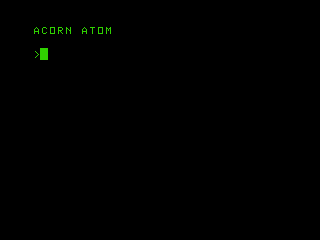
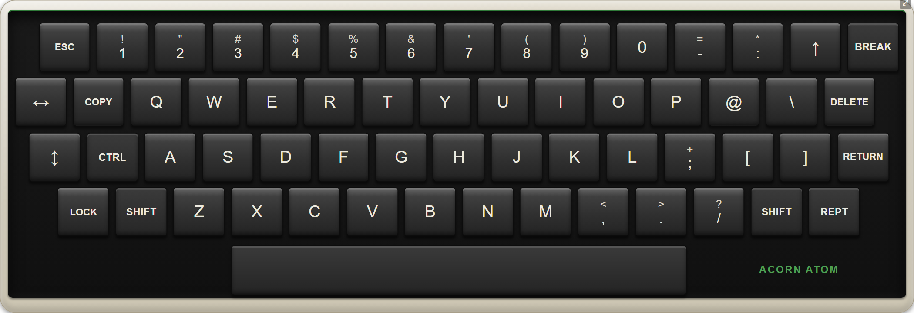

# Acorn Atom

Acorn's 1980 home computer: a 1 MHz 6502, a Motorola MC6847 VDG and an 8255 PPI
that joins the keyboard matrix, the VDG mode pins and the cassette/speaker
lines. zx84 emulates the standard 2 KB machine and the everyday 12 KB RAM
expansion, with the full 6847 text/semigraphic/graphics mode set.

   
  

| | |
| --- | --- |
| **Manufacturer** | Acorn Computers |
| **Released** | 1980 |
| **CPU** | MOS 6502 at 1 MHz |
| **zx84 kind** | `atom` — [`src/machines/atom/`](../../src/machines/atom/) |
| **Model ids** | `atom` |
| **Accuracy** | frame (whole 60 Hz field redrawn from display RAM) |
| **Status** | Working: boots Atom BASIC, keyboard, all 6847 modes, sound, cassette loading, snapshots. Disk is not emulated. |

**Legend:** ✅ supported · ◐ partial (see notes) · ✗ not emulated · — not applicable to this model

---

## Models

| Model | Year | RAM | ROM | Video | Sound | Storage | Notes |
| --- | --- | --- | --- | --- | --- | --- | --- |
| Acorn Atom (`atom`) | 1980 | 2 KB or 12 KB | 12 KB (BASIC 4K + FP 4K + kernel 4K) | MC6847, 256×192 | 1-bit speaker | cassette, optional 8271 disk | RAM size is a Hardware-pane setting |

### ROM sets

| Model | Locale | ROM pages | Source |
| --- | --- | --- | --- |
| `atom` | UK | 3 × 4 KB: BASIC at `$C000`, floating point at `$D000`, kernel at `$F000` | hosted at `acorn/atom-basic.rom`, `acorn/atom-float.rom`, `acorn/atom-kernel.rom`; replaceable from the ROM pane |

The three chips are concatenated in that order into one 12 KB system image. A
16 KB MAME-layout image (BASIC + FP at the bottom, kernel at `+$3000`) and a bare
4 KB kernel are also accepted by the ROM pane's drop classifier.

---

## Built-in hardware

| Part | Models | Status | Notes |
| --- | --- | --- | --- |
| MOS 6502 | all | ✅ | 1 MHz, 64 cycles per scanline, 262 lines per field |
| Motorola MC6847 VDG | all | ✅ | 32×16 text, semigraphics 4/6, 64×64×4 to 256×192×2 graphics |
| Intel 8255 PPI | all | ✅ | port A = keyboard row + VDG mode, port B = key columns, port C = cassette/speaker/CSS/VSYNC |
| MOS 6522 VIA | all | ✅ | printer/user port; its IRQ pin is not connected (LK2 absent) |
| Keyboard | all | ✅ | 10×6 matrix, CTRL/SHIFT on port B, REPT on port C |
| Speaker | all | ✅ | 1-bit output on port C bit 2 |
| Cassette interface | all | ✅ | CASIN on port C bit 5, a free-running 2400 Hz tone on bit 4; loads UEF/CSW/WAVE tapes through the OS's own 300-baud receiver |
| 8271 disk pack | — | ✗ | the optional DOS ROM and controller are not fitted |

---

## Peripherals

No add-on is modelled. The utility ROM at `$A000` and the DOS ROM at `$E000`
are left as open bus; the standard cassette-BASIC machine does not need them.

**Combination rules:** —.

---

## Media formats

| Extension | Kind | Device | Load | Save | Notes |
| --- | --- | --- | --- | --- | --- |
| `.atmstate` | snapshot | native state | ✅ | ✅ | deflated; refuses a corrupt/foreign file |
| `.txt`, `.bas` | BASIC listing | keyboard paste | ✅ | — | typed one key at a time at a readable pace |
| `.uef`, `.csw`, `.wav` | tape | cassette deck | ✅ | — | played at the pulse level; the OS's 300-baud CASIN routine does the decoding |

**Save menu exports:** native snapshot, PNG screenshot, RAM dump (`$0000-$9FFF`).

---

## Emulation features

| Feature | Status | Notes |
| --- | --- | --- |
| 6847 timing | ◐ | whole-frame render; the PPI's VSYNC input follows the 192-223 vblank window, so `WAIT` works |
| RAM expansion | ✅ | 2 KB standard or 12 KB expanded, chosen in the Hardware pane |
| Colour-board palette | ✅ | green/yellow/blue/red/buff/cyan/magenta/orange; text green or orange on black |
| Fast/turbo | ✅ | the shared frame-loop turbo path |
| Snapshots | ✅ | 64 KB RAM + CPU/PPI/VIA/VDG state |
| BASIC listing and variables | ✅ | untokenised text-space lines; A-Z 32-bit integers; dimensioned AA-ZZ arrays |
| Cassette loading | ✅ | UEF (300 baud, 1200 Hz base), CSW and WAVE play through the pulse deck; the OS finds the named file, checks its blocks and returns to the prompt |
| On-screen keyboard | ✅ | the Atom's QWERTY deck laid out over its 10×6 matrix cells, with latched CTRL/SHIFT/REPT and BREAK |
| Screen OCR / TEXT overlay | ✅ | 32×16 text screen only; graphics modes have no text to transcribe |
| Trace | ✅ | full and memory-mapped I/O tally modes |

---

## Tools and integration

| Tool | Status | Notes |
| --- | --- | --- |
| Debugger (breakpoints, stepping, disassembly) | ✅ | shared 6502 debug service |
| Trace | ✅ | `full`, `portio`; I/O windows `$B000-$B3FF` and `$B800-$BBFF` |
| Screen OCR / TEXT overlay | ◐ | text mode only |
| Software library | ✗ | no Atom catalog |
| Machine-specific panes | ✅ | Hardware RAM selector; on-screen QWERTY keyboard; BASIC listing and A-Z/AA-ZZ variable panes |
| MCP tools | ✅ | the generic 6502 tools plus the Chips dump (`ppi`, `via`, `vdg`) |

---

## Known issues

| Issue | Affects | Severity | Notes |
| --- | --- | --- | --- |
| No cassette saving | all | medium | CASOUT is not recorded; `SAVE` still prints `RECORD TAPE` but writes nothing |
| No disk pack | all | medium | 8271/DOS software cannot run |
| Utility/DOS ROM sockets are open bus | all | low | software that calls `$A000`/`$E000` directly sees `$FF` |
| Display redraws once per frame | all | low | programs that change the 6847 mode mid-frame show the final mode for the whole frame |
| Typed listings are paced, not handshaked | all | low | a listing is held for 3 frames and released for 3; very slow executables may drop a key |

## Not emulated

- **Cassette saving** — CASOUT is not captured, so the Save menu offers no tape
  image.
- **Disk pack** — the 8271 controller, DOS ROM and drives are absent.
- **Utility ROM (`$A000`)** and **DOS ROM (`$E000`)** — open bus, so the
  assembler/disassembler/extra commands and DOS entry points are unavailable.
- **Econet and the 6522 printer handshake** — the VIA is fitted, but its IRQ is
  not wired and printer output is not captured.

## Faithful quirks

- **Active-low keyboard.** An idle row reads `$FF`; a pressed key clears its
  column bit, and CTRL/SHIFT clear bits 6/7.
- **REPT is not CTRL.** The Atom's right-hand key is REPT and is read on port C
  bit 6; host `ControlRight`/`AltRight` drives it without asserting CTRL.
- **The BIOS waits for a release.** OSRDCH ignores a key that is already down
  when it reaches the release-wait phase, which is why a pasted listing holds
  and releases each key rather than toggling it for one frame.
- **Text codes are not ASCII.** `$00-$1F` are `@`, A-Z, `[ \ ] ^ _`;
  `$20-$3F` are ASCII; `$80-$BF` repeat those two ranges inverted; `$40-$7F`
  and `$C0-$FF` are semigraphics.
- **VSYNC reads low in blanking.** PPI port C bit 7 is 0 on scanlines 192-223,
  which is the level `WAIT` and the OS's screen timing poll.
- **`PLAY TAPE` means start the recorder.** The Atom has no motor relay, so the
  deck moves whenever it is playing. Mount a tape, type `LOAD "…"`, then let the
  tape play (the pane's Play button starts one that is stopped) and press a key
  when `PLAY TAPE` appears. `LOAD` scans for the named file rather than reading
  from the tape's current block.

---

## Verification

| Reference | Result | Last checked |
| --- | --- | --- |
| `tests/atom.test.ts` | registration, memory map, keyboard, PPI/VIA mirrors, boot + PRINT with the real ROMs, BASIC listing/variables, cassette mount and CASIN levels, CLEAR/DRAW, snapshot round trip | 2026-11-22 |
| `tests/atom-basic.test.ts` | text-space line records, 2 KB base, machine-code block termination, A-Z columns, AA-ZZ dimensions | 2026-11-22 |
| `tests/tape/uef.test.ts` | UEF pulse decoding, including the forced 1200 Hz base and dropped negative-stop short wave the Atom uses | 2026-11-22 |
| `tests/i8255.test.ts` | mode 0 directions and port-C bit set/reset against the datasheet | 2026-11-22 |
| `tests/mc6847.test.ts` | text, inverse, semigraphics and graphics-mode pixel geometry | 2026-11-22 |
| Hosted Acorn ROM set (`atom-basic.rom`, `atom-float.rom`, `atom-kernel.rom`) | boots to `ACORN ATOM` / `>` and runs `PRINT "HI"` | 2026-11-22 |
| Breakout UEF (`mcp/.cache/atom-breakout.uef`, not redistributable) | `LOAD "BREAKOUT"` loads its BASIC lines and machine code, then returns to `>` with no `SUM`/`ERROR` | 2026-11-22 |
