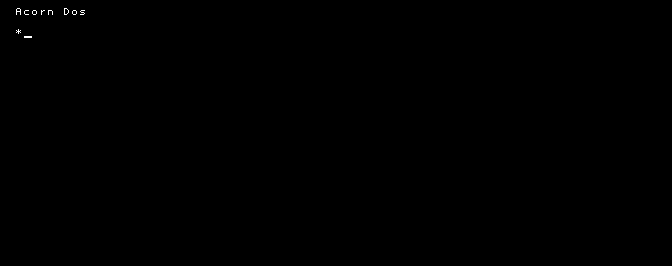
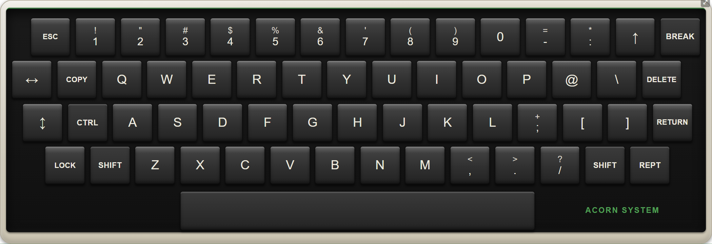

# Acorn System

Acorn's Eurocard range — the modular machines the BBC Micro grew out of. Each
system is a 19" card frame of 100×160 mm boards on the standard Acorn bus: a
6502 CPU card, a memory card, a VDU card, and optionally a disc controller.
zx84 emulates the System 2, 3, 4 and 5 as one machine family assembled from
those card sets; the System 1 (the LED-and-keypad kit) is not implemented.

   
  

| | |
| --- | --- |
| **Manufacturer** | Acorn Computers |
| **Released** | 1980–1982 |
| **CPU** | MOS 6502 at 1 MHz (System 2/3/4), 6502A at 2 MHz (System 5) |
| **zx84 kind** | `acorn-system` — [`src/machines/acorn-system/`](../../src/machines/acorn-system/) |
| **Model ids** | `acorn-system2` `acorn-system3` `acorn-system4` `acorn-system5` |
| **Accuracy** | frame (the VDU card reads its own character RAM; whole screen redrawn per field) |
| **Status** | Working: all four boot their real ROM, run BASIC, take discs and cassettes, and drive the VDU cards from the CRTC's registers. |

**Legend:** ✅ supported · ◐ partial (see notes) · ✗ not emulated · — not applicable to this model

---

## Models

| Model | Year | RAM | ROM | Video | Sound | Storage | Notes |
| --- | --- | --- | --- | --- | --- | --- | --- |
| System 2 (`acorn-system2`) | 1980 | 1 KB CPU card + 8 KB card | 2 KB COS at `&F800`, 4 KB BASIC at `&C000` | 40×25 teletext (MC6845 + SAA5050) | — | cassette | disc-less member; the cassette OS is the resident OS |
| System 3 (`acorn-system3`) | 1980 | 1 KB + 8 KB | 4 KB DOS/kernel at `&F000`, 4 KB BASIC at `&C000` | 40×25 teletext | — | cassette + 8271, two drives | adds the floppy controller card (200,004) |
| System 4 (`acorn-system4`) | 1981 | 1 KB + 16 KB | as System 3 | 40×25 teletext | — | as System 3 | double-height frame; second 8 KB card at `&4000` |
| System 5 (`acorn-system5`) | 1982 | 2 KB + 48 KB | 4 KB DOS/kernel (80-column) at `&F000`; BASIC from disc | 80×25 mono (MC6845 + 8×8 generator) | — | cassette + 8271, two drives | buffered 6502A card with a 6522A; 48 KB of dynamic RAM |

### ROM sets

| Model | Locale | ROM pages | Source |
| --- | --- | --- | --- |
| `acorn-system2` | UK | 2 KB COS/kernel (`&F800`) + 4 KB integer BASIC (`&C000`) | hosted at `acorn-system/syscos40.rom` and `acorn-system/system-basic.rom` |
| `acorn-system3`, `acorn-system4` | UK | 4 KB DOS + kernel (`&F000`) + 4 KB integer BASIC | hosted at `acorn-system/sysdos40.rom` and `acorn-system/system-basic.rom` |
| `acorn-system5` | UK | 4 KB DOS + kernel, 80-column (`&F000`) + the 2 KB character generator | hosted at `acorn-system/sysdos80.rom` and `acorn-system/80x25font.rom` |

The system ROM's size picks the model: a 2 KB image is the COS at `&F800` and
lands on a System 2, a 4 KB image is a DOS/kernel at `&F000` and lands on a
System 3. The other cards' firmware is fetched separately by the machine's
`prepare()` hook, because it lives on its own card: the resident BASIC on the
8 KB RAM + 8 KB ROM card, and the 80×25 card's character generator. A failed
fetch leaves that card empty rather than stopping the machine.

BASIC is the 4K integer interpreter, held as plain text with a keyword
dispatch table rather than tokens. The System 5 has no BASIC ROM — its DOS
loads BASIC from disc into the dynamic RAM — so the BASIC panes follow the
interpreter's workspace pointers instead of the ROM's presence.

---

## Built-in hardware

| Part | Models | Status | Notes |
| --- | --- | --- | --- |
| MOS 6502 | 2, 3, 4 | ✅ | 1 MHz, 64 cycles per scanline, 312 lines per field |
| MOS 6502A | 5 | ✅ | 2 MHz, 128 cycles per scanline (buffered address bus) |
| INS8154 RAM/IO | 2, 3, 4 | ✅ | [`src/cores/ins8154.ts`](../../src/cores/ins8154.ts): 128-byte RAM above A7, four registers mirrored on A0/A1 below it. Keyboard on port B, cassette on port A |
| MOS 6522A VIA | 5 | ✅ | replaces the 8154: keyboard on ORA at `&0E21`, user port on B |
| MC6845 CRTC | all | ✅ | `&0800` (teletext) or `&1840` (80×25) |
| SAA5050 teletext generator | 2, 3, 4 | ✅ | rounded 12×10 cell, eight colours, alpha and mosaic |
| 8×8 character generator | 5 | ✅ | 2 KB ROM, 640-dot line, ten scanlines per row |
| Keyboard | all | ✅ | parallel ASCII encoder: a code on the port with bit 7 low while a key is down |
| CUTS cassette | all | ◐ | bit 7 in, bit 6 out, 300 baud; loads UEF/CSW/WAVE, does not record |
| 8271 floppy controller | 3, 4, 5 | ✅ | card at `&0A00`, interrupt on the CPU's NMI; single density, two drives |
| Speaker | all | — | none in the range |

---

## Peripherals

Nothing is user-fittable in the Hardware pane: a real system's cards were
chosen when it was ordered, so the model fixes the card set.

**Combination rules:** —.

---

## Media formats

| Extension | Kind | Device | Load | Save | Notes |
| --- | --- | --- | --- | --- | --- |
| `.ssd`, `.dsd` | disk | drive 0/1 | ✅ | ✅ | ten 256-byte FM sectors per track, 40 or 80 track, either side |
| `.img`, `.dsk` | disk | drive 0/1 | ✅ | ✅ | layout sniffed; written back as `.ssd`/`.dsd`, or `.hfe` when the layout is irregular; a double-density disc is refused |
| `.hfe`, `.scp` | disk | drive 0/1 | ✅ | ✅ | decoded track by track; written back as HFE when the layout is not a plain sector dump |
| `.uef`, `.csw`, `.wav` | tape | cassette deck | ✅ | ✗ | played at the pulse level; the COS/DOS's own 300-baud reader does the decoding |

**Save menu exports:** PNG screenshot, RAM dump (CPU-card RAM followed by every
RAM card).

---

## Emulation features

| Feature | Status | Notes |
| --- | --- | --- |
| Timing | ✅ | the CPU runs flat out; the VDU card reads its character RAM transparently, so there is no contention or cycle stealing |
| Teletext colours | ✅ | the SAA5050's eight colours, PAL or measured levels (Display pane) |
| 80×25 card | ✅ | monochrome glyph renderer with the hardware cursor in the tenth scanline |
| Hardware cursor | ✅ | CRTC R10/R11 start/end, R14/R15 address, 1/16 or 1/32 field blink |
| Fast/turbo | ✅ | the shared frame-loop turbo path; engages while a tape is being read |
| BASIC listing and variables | ✅ | plain-text program lines from PAGE, A–Z 32-bit integers, live FOR loops |
| Screen OCR / TEXT overlay | ✅ | reads the character RAM through the CRTC's window, with each cell's SAA5050 ink and paper |
| On-screen keyboard | ✅ | the shared Acorn ASCII deck (the Atom's), driving the System's encoder; COPY is Ctrl-Q and the arrows are the DOS's cursor moves |
| Trace | ✅ | full and memory-mapped I/O tally modes |

---

## Tools and integration

| Tool | Status | Notes |
| --- | --- | --- |
| Debugger (breakpoints, stepping, disassembly) | ✅ | shared 6502 debug service |
| Trace | ✅ | `full`, `portio`; I/O windows `&0800-&1FFF` |
| Screen OCR / TEXT overlay | ✅ | text only (both cards are character displays) |
| Software library | ✗ | no System catalogue |
| Machine-specific panes | ✅ | BASIC listing and variables; on-screen ASCII keyboard; drive pane on the disc models |
| MCP tools | ✅ | the generic 6502 tools; the 8271 and CRTC state are visible through the memory pane |

---

## Known issues

| Issue | Affects | Severity | Notes |
| --- | --- | --- | --- |
| No save states | all | medium | the family has no snapshot service, so nothing is carried across a reload |
| Cassette saving | all | medium | the CUTS output is not recorded; the COS/DOS `SAVE` completes but produces no downloadable tape |
| FLOAD untested on genuine media | 2 | low | the loader's framing is implemented from the COS source but no real System tape image has been tried |
| Fixed dynamic-RAM size | 5 | low | 48 KB (`&2000-&9FFF` plus `&A000-&DFFF`); real cards were linkable, so a 32 KB-only machine is equally valid |
| BASIC panes need a running interpreter | all | low | the panes read the workspace pointers, so a cold machine (or one that never started BASIC) shows nothing |

## Not emulated

- **System 1** — the 1979 LED-and-keypad kit. It shares the CPU card but needs a
  seven-segment display and hex-keypad pane, so it is a separate piece of UI
  rather than a model of this family.
- **Versatile Interface Board** (`&0C00`: 6522 / 6850 / 8255) — open bus, so
  software that uses its serial, parallel or printer ports sees no card.
- **Econet** — the node and its 6854 are absent.
- **Second 8 KB ROM card** — only the RAM half of the second card is fitted.
- **Cassette recording** — see above; the Save menu offers no tape image.

## Faithful quirks

- **Unclaimed addresses read `&00`, not `&FF`.** The kernel's printer path reads
  the absent VIB's control register and exits when it reads zero, and the disc
  routines poll an absent 8271 for "not busy" as bit 7 clear; a floating-high bus
  would hang both on a machine that has neither card.
- **The 8271's data port is at `+4`, not `+3`.** The DOS's disc NMI handler is
  literally `LDA &0A04`, the same offset the BBC's 8271 interface uses.
- **The keyboard answers at `&0E21` on every card.** On the 1 MHz cards that is
  the 8154's port B data register; on the 6502A card it is the 6522's ORA. The
  system software reads the same address either way.
- **A fitted BASIC ROM masks a disc-loaded BASIC.** On a System 3/4 the DOS's
  `RUN BASIC` loads the disc copy to `&C000` behind the ROM socket, so the ROM's
  interpreter keeps running — which is what the real machine does with that part
  fitted.
- **The cassette has no motor relay.** The COS/DOS cannot start or stop the
  transport, so the deck moves whenever it is playing; the Tape pane's Play and
  Pause are the recorder's own controls.
- **The teletext card's control codes share the 1K with the text.** A row's
  colour is whatever control bytes preceded it, so the renderer and the OCR both
  have to run the row through the SAA5050 in order.

---

## Verification

| Reference | Result | Last checked |
| --- | --- | --- |
| `tests/acorn-system.test.ts` | 8154 register map, ROM boot, keyboard encoders (8154 and 6522), System 3 card decode with a full DRAM-paced sector read, System 5 clock/RAM/VDU windows, BASIC listing and variables, transcription, cassette levels, on-screen keyboard mapping | 2026-11-22 |
| Hosted COS (`syscos40.rom`) + BASIC | System 2 boots to `Acorn Cos`, `*BASIC`, `PRINT 2+2` → `4` | 2026-11-22 |
| Hosted 40-column DOS (`sysdos40.rom`) + `System BASIC.ssd` | System 3 and 4 boot to `Acorn Dos`, `CAT` lists the disc, `RUN BASIC` loads it and `PRINT 2+2` → `4` | 2026-11-22 |
| Hosted 80-column DOS (`sysdos80.rom`) + character generator + `System BASIC.ssd` | System 5 boots to `Acorn Dos`, `CAT`, `RUN BASIC` (loaded into the dynamic RAM at `&C000`), `PRINT 2+2` → `4` | 2026-11-22 |
