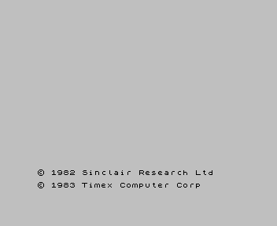
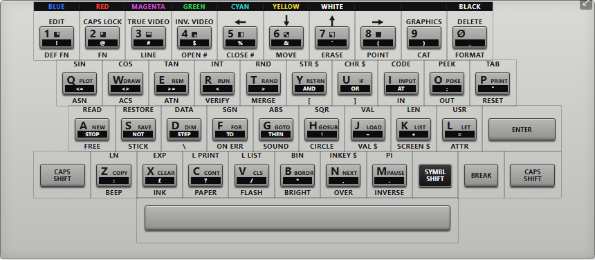

# Timex Sinclair 2068 / Timex Computer 2068

Timex's own Spectrum-derived machine: the TC2048's "SCLD" ULA and screen modes, a
24K ROM with an 8K extension ROM (EXROM) that the BASIC calls into, a horizontal
memory mapper that swaps 8K chunks of the address space for the EXROM or for a
cartridge in the dock connector, an AY-3-8912 sound chip, and two Atari-style
joystick ports read through the AY. zx84 emulates them as one model of the Spectrum
machine in two TV standards, sharing its CPU, tape, snapshot and software tooling with the
[TC2048](timex-computer-2048.md), whose SCLD video it reuses.

   
  

| | |
| --- | --- |
| **Manufacturer** | Timex Computer Corporation (US, the TS2068) and Timex Computer (Portugal, the TC2068) |
| **Released** | 1983 (TS2068), 1984 (TC2068) |
| **CPU** | Zilog Z80A — 3.528 MHz |
| **zx84 kind** | `spectrum` — [`src/machines/spectrum/`](../../src/machines/spectrum/) |
| **Model ids** | `ts2068` — the MCP `model` target and `?model=` value. The locale picks the TV standard, as on the C64: `us` is NTSC (the TS2068), any other PAL (the TC2068). The model menu offers it as Timex 2068 PAL / NTSC |
| **Accuracy** | Per-T-state CPU with ULA contention; scanline display with mid-line (rainbow) rendering, including mid-frame screen-mode changes |
| **Status** | Working — boots the real ROM, loads from tape, pages the EXROM and dock cartridges; the TS2068's frame layout and the contention timing are estimates, not hardware-verified |

**Legend:** ✅ supported · ◐ partial (see notes) · ✗ not emulated · — not applicable to this model

---

## Models

| Model | Year | RAM | ROM | Video | Sound | Storage | Notes |
| --- | --- | --- | --- | --- | --- | --- | --- |
| Timex Sinclair 2068 (`ts2068`, NTSC) | 1983 | 48 KB | 16 KB HOME + 8 KB EXROM | The TC2048's modes; a 60 Hz, 262-line frame | Beeper, AY-3-8912 | Cassette, dock cartridges | The US machine |
| Timex Computer 2068 (`ts2068`, PAL) | 1984 | 48 KB | 16 KB HOME + 8 KB EXROM | The TC2048's modes; a 50 Hz, 312-line frame | Beeper, AY-3-8912 | Cassette, dock cartridges | The Portuguese machine; the TC2048's frame timing |

### ROM sets

| Model | Locale | ROM pages | Source |
| --- | --- | --- | --- |
| `ts2068` | `uk` (PAL), `us` (NTSC): the same ROM | 24 KB: the HOME ROM, then the EXROM | hosted (`timex/tc2068-0.rom` + `timex/tc2068-1.rom`) |

Both standards use the TC2068's ROM pair. The sources describe no difference between
the TS2068's and TC2068's ROMs; if you have a TS2068 pair, drop it on the ROM pane
as a single 24 KB file (the HOME ROM followed by the EXROM). Dropping a 16 KB image
replaces only the HOME ROM and keeps the EXROM.

---

## Built-in hardware

| Part | Models | Status | Notes |
| --- | --- | --- | --- |
| Z80 CPU | all | ✅ | Shared core; 3.528 MHz |
| SCLD (Timex ULA) | all | ◐ | As on the [TC2048](timex-computer-2048.md): port 0xFF screen modes, hi-colour, 512-pixel hi-res, the interrupt-disable bit. Port 0xFF bit 7 also selects the EXROM or the dock for the mapper |
| Horizontal memory mapper | all | ✅ | [`timex-mmu.ts`](../../src/machines/spectrum/timex-mmu.ts), ports 0xF4 and 0xFF bit 7; see below |
| AY-3-8912 | all | ✅ | Ports 0xF5 (register select) and 0xF6 (data), clocked at half the CPU clock (1.764 MHz) and mixed to one speaker |
| Joystick ports | all | ✅ | Two Atari-style ports on the AY's I/O port (register 14); see below |
| Memory contention | all | ◐ | The Ferranti pattern over 0x4000–0x7FFF, from T 14320 on the TC2068 and from the TS2068's own estimated start (below). Memory swapped over 0x4000–0x7FFF is still treated as contended |
| Keyboard | all | ✅ | The 48K matrix; `IN 0xFE` has bits 5 and 7 clear. The on-screen keyboard is the 2068's own: the TC2048's key layout on a silver case, with the 2068 BASIC's FREE, STICK, ON ERR, SOUND and RESET under A, S, F, G and P |
| Cassette interface | all | ✅ | Pulse-level deck. The ROM's loader runs in real time, with the loader detector speeding the tape; there is no instant LOAD trap, because the 2068's tape routines are not the 48K's |
| Kempston joystick port | — | — | None: nothing answers 0x1F |

### The mapper (ports 0xF4 and 0xFF)

| Port | Bits | Meaning |
| --- | --- | --- |
| 0xF4 | 0–7 | Bit n set swaps the alternate bank in for 8K chunk n (bit 0 is 0x0000–0x1FFF, bit 7 is 0xE000–0xFFFF); clear leaves it to HOME. IN returns the last byte written; power-up is 0 |
| 0xFF | 7 | Which alternate bank: 0 the DOCK (a cartridge), 1 the EXROM |

The DOCK and EXROM are exclusive; HOME chunks mix freely with either.

- **EXROM** — the 8K ROM answers in every chunk that selects it (it is not decoded to
  one position), so the same 8K shows at each.
- **DOCK** — a chunk the cartridge does not populate, or any chunk with no
  cartridge fitted, reads 0xFF.
- **ROM and RAM** — HOME ROM and any alternate ROM ignore writes. A dock chunk the
  cartridge makes RAM takes them and keeps what is written when swapped out.
- **HOME underneath** — the RAM a swapped chunk hides is kept intact and returns
  when the chunk is swapped back. The ULA still draws from it, so a chunk swapped
  over the screen does not change the picture.
- **Reset** — both ports go to 0.

### Joysticks (AY register 14)

Select register 14 (`OUT 0xF5, 14`) with register 7 bit 6 clear (the port set to
input), then `IN 0xF6`. Address line A8 chooses the left joystick and A9 the right;
both chosen reads the OR of the two, and neither reads 0xFF. A held direction reads
0: bit 0 up, 1 down, 2 left, 3 right, 7 fire. Each player in the Joystick pane picks
which port their stick is in.

The sources disagree on the fire bit (Alvin Albrecht's port map says bit 7, loadzx.com's
port page says bit 4); bit 7 is used, which leaves bits 4–6 reading 1.

### Frame timing

| Standard | Frame | Clock | Notes |
| --- | --- | --- | --- |
| PAL | 224 T × 312 lines = 69,888 T, 50.5 Hz | 3.528 MHz | The TC2048's: contention from T 14320, first pixel at 14321 |
| NTSC | 224 T × 262 lines = 58,688 T, 60.1 Hz | 3.528 MHz | The lines are the NTSC standard's. The picture is placed after 16 lines of vertical retrace and 24 of border; contention starts at T 8944 and the first pixel is at 8945. Estimated: the Timex literature gives the 60 Hz rate and not the layout |

The display shows 48 border lines above and below the picture, which a 262-line frame
cannot hold: the rows beyond the 24 above and the 30 below the picture are drawn in
the border colour at the ends of the frame, so border effects only land on the
lines the machine really has.

---

## Peripherals

| Peripheral | Type | Models | Status | Notes |
| --- | --- | --- | --- | --- |
| Dock cartridges (`.dck`) | ROM / RAM | all | ✅ | Cartridge slot in the ROM pane; see below |
| Joysticks | input | all | ✅ | Two ports, always present |
| SpecDrum | sound | all | ✅ | Port 0xDF, as on the TC2048 |
| Interface 1, +D, Beta Disk, Multiface, µSpeech, Interface 2, mice | — | — | ✗ | The 2068's edge connector is not decoded for the Spectrum interfaces; none are offered |
| Timex FDD (floppy) and the 2040 printer | — | — | ✗ | Not emulated |

### Dock cartridges

A `.dck` file holds one or more banks, each a bank id and eight chunk types followed
by the images for the chunks that have one:

| Bank id | Meaning |
| --- | --- |
| 0 | DOCK: chunks swapped in with port 0xF4 and port 0xFF bit 7 clear |
| 254 | EXROM: overrides the built-in EXROM in the chunks it names |
| 255 | HOME: replaces the HOME ROM (chunks 0 and 1), so a cartridge can carry its own ROM such as a Spectrum ROM |
| 1–253 | Reserved: skipped |

| Chunk type | Meaning |
| --- | --- |
| 0 | Nothing there |
| 1 | RAM, no image (starts zeroed) |
| 2 | ROM, with an 8,192-byte image |
| 3 | RAM, with an 8,192-byte image as its initial contents |

Inserting or ejecting a cartridge restarts the machine, as plugging one in with the
power off would. A file that is truncated, too short or holds an unknown chunk type
is refused with the reason, and the machine is left as it was. Dropping a `.dck` on
any other machine says it needs a Timex 2068.

---

## Media formats

The Spectrum's `.tap`, `.tzx`, `.csw`, `.wav`, `.zip` and snapshots, plus `.dck`.

| Extension | Kind | Device | Load | Save | Notes |
| --- | --- | --- | --- | --- | --- |
| `.dck` | cartridge | dock | ✅ | ✗ | |
| `.szx` | snapshot | RAM, CPU, AY, screen mode, mapper | ✅ | ✅ | Machine id 12 (TS2068) when saved in NTSC, 9 (TC2068) in PAL; either loads in either standard; the `SCLD` block holds ports 0xF4 and 0xFF. The cartridge itself is not in the file: a DOCK selection is only restored while a cartridge is fitted, so an empty dock is never swapped over the program. A 2068 file offered to any other machine asks for a 2068 |
| `.z80` | snapshot | RAM, CPU | ◐ | ✗ | Loads hardware modes 15 (TC2068) and 128 (TS2068) as 48K RAM with the screen mode; the format has nowhere for port 0xF4, so the mapper comes back at HOME. Not offered for saving |
| `.sna`, `.sp` | snapshot | RAM, CPU | ✅ | ✗ | Load onto the current machine. They assume a 48K ROM: a 2068 only runs them with a Spectrum ROM cartridge fitted |

The Save menu's screen dumps, multicolour `.mlt` and screenshot are the TC2048's
(see its page).

---

## Tools and integration

| Tool | Status | Notes |
| --- | --- | --- |
| Debugger, trace | ✅ | The Spectrum's Z80 debugger; it sees memory as the CPU does, with swapped chunks in place |
| Screen OCR / TEXT overlay | ✅ | As on the TC2048, including the hi-res grids |
| Software library | ◐ | The titles ZXDB tags for the TC2048 play on a 2068 too, with the library's one-click LOAD typed at the 2068's editor. The 2068-only titles ZXDB lists are not in the library |

---

## Known issues

| Issue | Affects | Severity | Notes |
| --- | --- | --- | --- |
| NTSC frame layout | `ts2068` in NTSC | low | The 262-line frame and the picture's position in it are estimated; see above |
| Contention under a swapped chunk | memory over 0x4000–0x7FFF | low | Contended as the RAM it hides, not as the dock or EXROM chip it shows |
| Snapshots and cartridges | `.szx` | low | A cartridge's RAM contents are not saved |
| No instant tape loading | tape | low | The 2068's tape routines differ from the 48K's, so there is no ROM trap; tapes load in real time with auto-speed |
| Bank views while swapped | snapshots, debugger | low | While a chunk is swapped over RAM, the RAM bank views a snapshot reads are a copy of the hidden RAM, current only until the next write |

## Not emulated

- The Timex FDD floppy system, the TS2040 printer, the TS2050 modem and the ZX81-style expansion bus of the TS2068.
- Cartridge-slot extras beyond `.dck` memory (a cartridge's own peripherals).

## Faithful quirks

- The EXROM appears at every chunk that selects it, and an empty DOCK reads 0xFF.
- Reading port 0xFF or 0xF4 returns the last byte written, and unattached ports read 0xFF.
- The AY's I/O port is the joystick port; reading it with the port set to output returns what was written.

---

## Verification

| Reference | Result | Last checked |
| --- | --- | --- |
| `tests/machines/spectrum/timex2068.test.ts` (the mapper, EXROM mirroring, HOME RAM preservation, `.dck` parsing and mapping, the AY ports, the joystick bits and selection, snapshots; boots the real ROM, types `LOAD ""` and loads a program from tape, and checks the whole frame is drawn when the TC2068 ROM pair is to hand) | Passing | 2026-11-21 |
